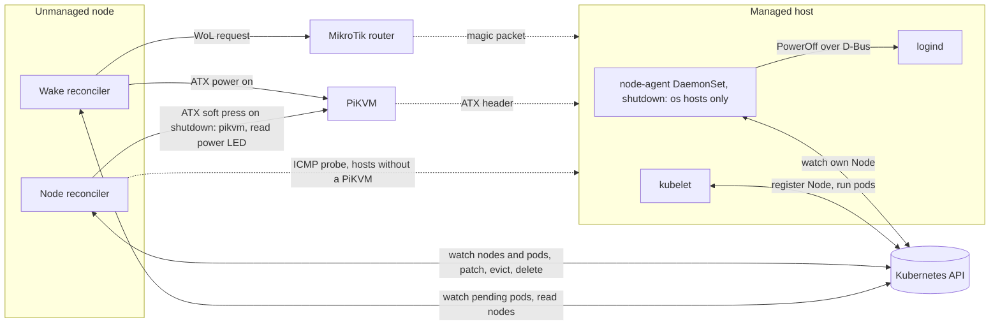
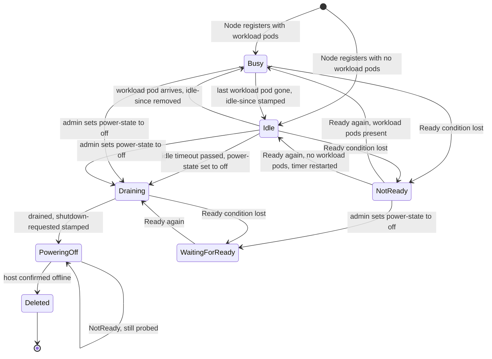
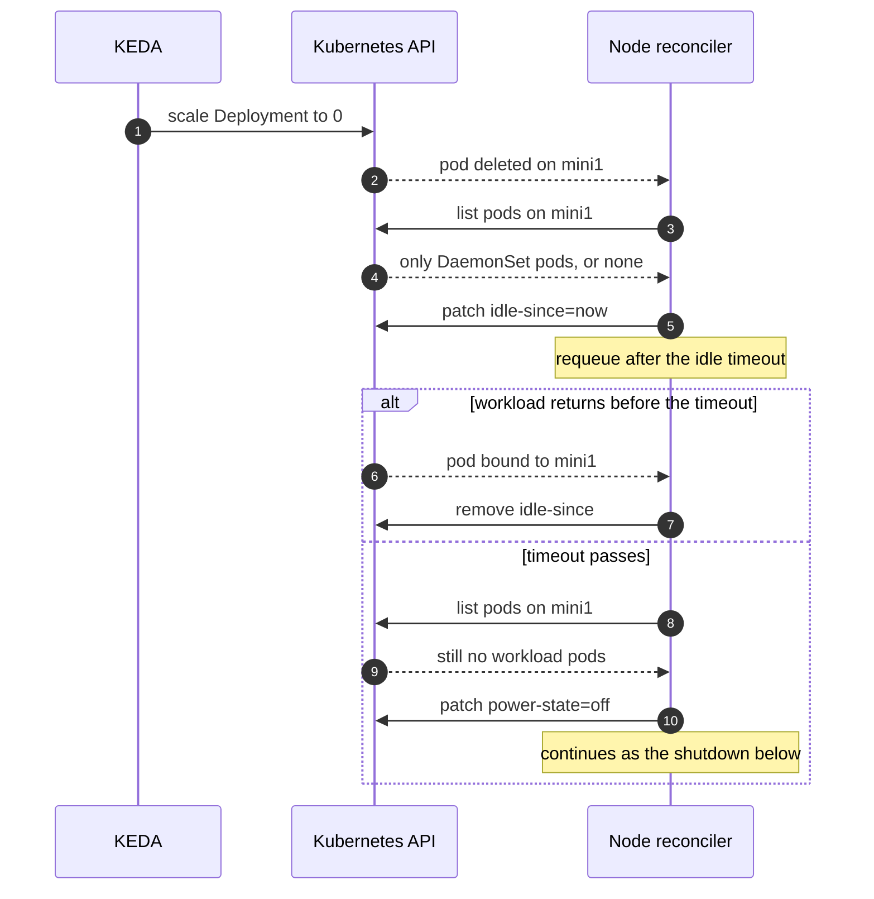
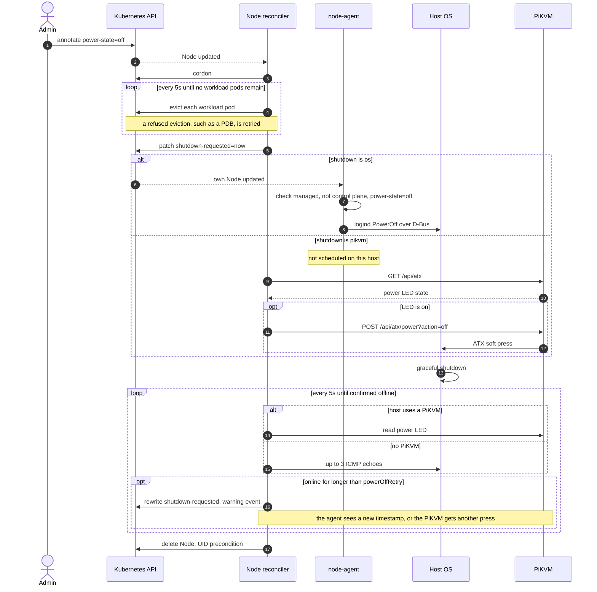
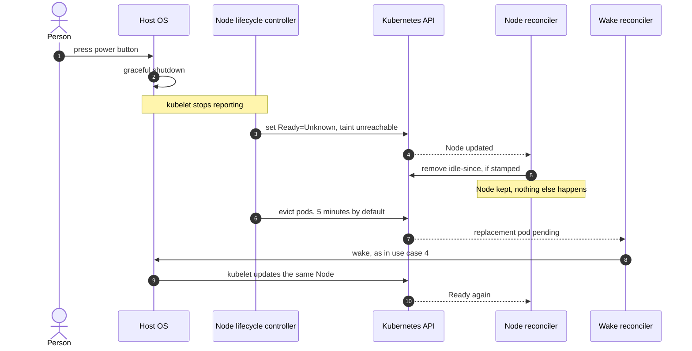
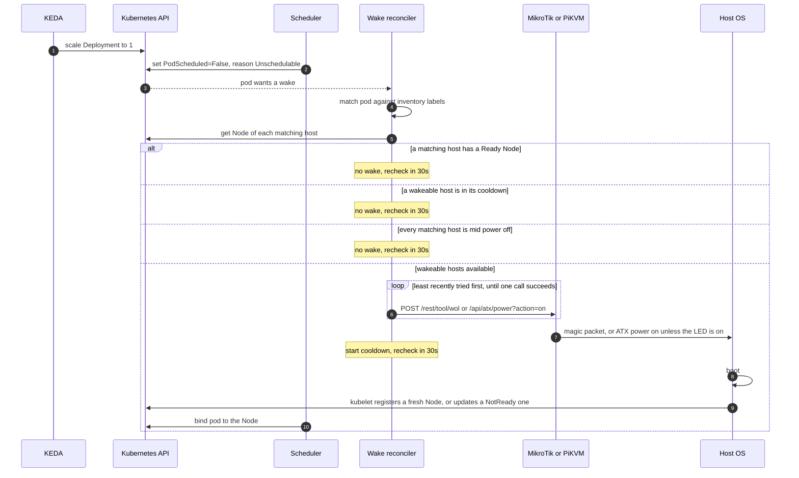

# How it works

Nekromancer keeps all shutdown progress in Node annotations, so a controller restart resumes wherever it stopped.
The controller's only in-memory state is the wake cooldown; losing it costs at most one redundant wake.

## Components

## Node state

The Node reconciler picks one branch on every reconcile, based only on the current Node.

Nodes without `managed: "true"`, control plane nodes, and nodes missing from the inventory never enter this state machine.

## Use case 1: idle detection

Pod events on a node trigger a reconcile of that node. A timer covers the case where nothing else changes.

## Use case 2: shutdown

Manual shutdown enters here directly through `kubectl annotate`, and idle shutdown enters here through the patch above.
The Node is kept until the host is confirmed down.
Each host uses exactly one shutdown method, picked in the inventory.

A probe error counts as online, so uncertainty never deletes a Node.
These are the plain ATX calls, used with `pikvmPort: ""`. Any other host makes the same calls through the Switch API:
`GET /api/switch`, then `POST /api/switch/atx/power?port=<index>&action=off`, with the port found by name, by default the host name.

## Use case 3: physical power button

Nekromancer doesn't act on this. A host that was switched off and one that is cut off by a network partition look the same,
and deleting the Node of a running host would let its pods start elsewhere while the originals still run.
So the Node stays `NotReady`, and the only change is to the idle timer and to what can be woken.

If `power-state=off` is set on a NotReady Node, it's cordoned and the shutdown waits for Ready.
The host can't see a request until then, so its silence wouldn't prove it had shut down.

## Use case 4: resurrection

The Node is gone or NotReady, so the pending pod is the only signal.
Its `nodeSelector` and required node affinity are matched against the static inventory.

Pods without a `nodeSelector` or required node affinity, DaemonSet pods, and pods already bound to a node never wake anything.
